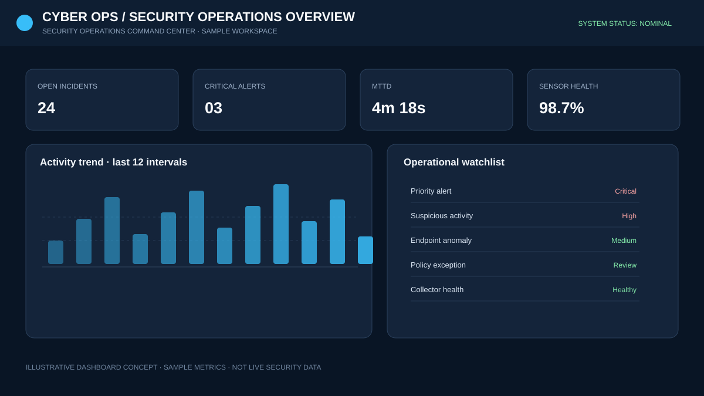
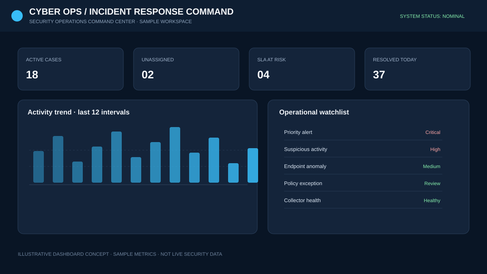
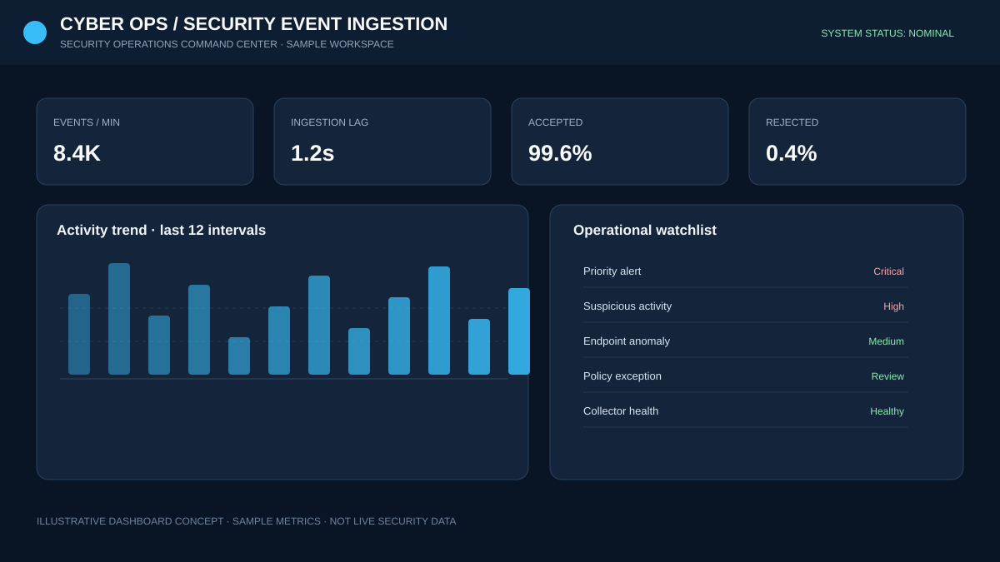
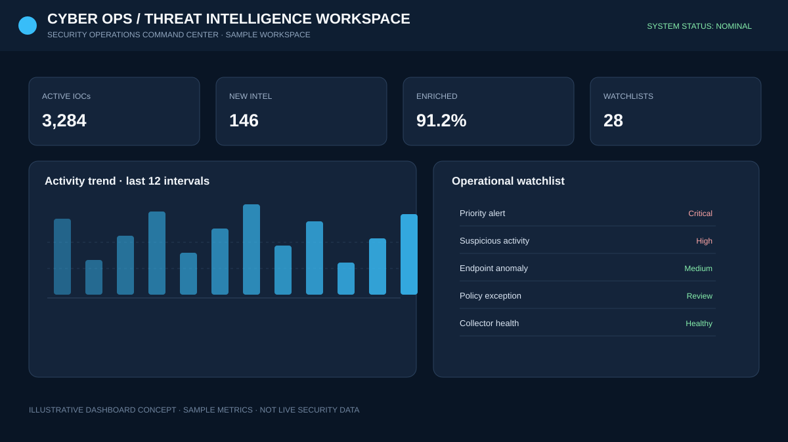
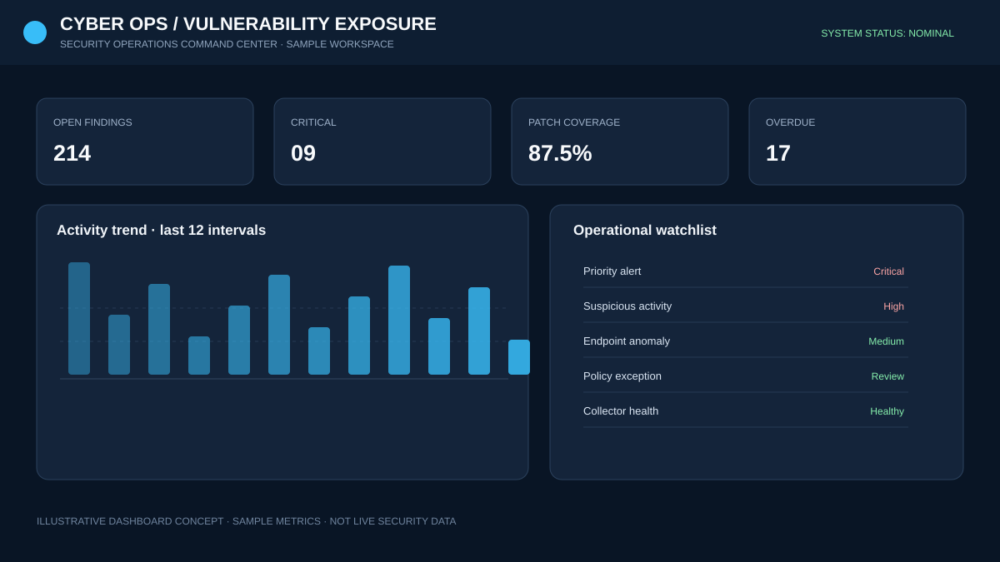
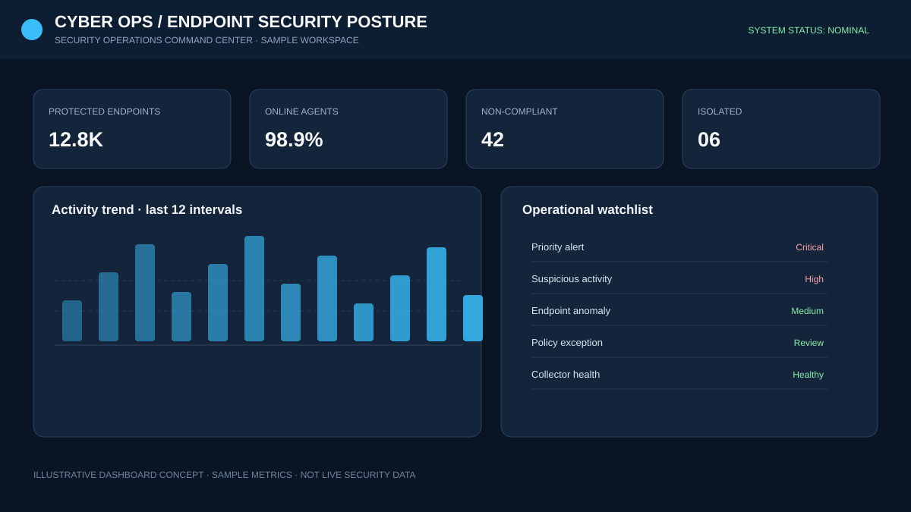
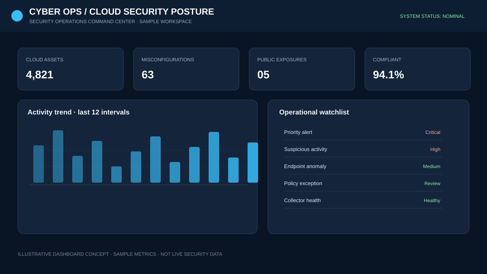

# SOC Command Center — Security Operations Platform

An early-stage, defensive security operations portfolio project exploring tenant-aware identity, security-event workflows, detection findings, auditability and realtime updates.

**Status:** Active development · not production-ready  
**Scope:** SOC / SIEM / SOAR / GRC concepts  
**License:** No open-source license has been selected; all rights reserved unless a license is added.

## Product direction

The intended workflow is:

**Collect → Normalize → Detect → Investigate → Respond → Evidence**

The long-term product direction includes:

- Security-event ingestion, normalization and search.
- Versioned detection rules and explainable findings.
- Incident investigation and response workflows.
- Tenant-scoped asset and vulnerability management.
- Approval-controlled SOAR playbooks.
- Compliance controls, evidence and audit reporting.

These are product goals, not a claim that every module is implemented. See the [implementation roadmap](docs/ROADMAP.md) for capability-level status.

## Current engineering foundation

The repository currently contains a pnpm TypeScript workspace with:

- An Express 5 API and a Vite/React web application.
- Tenant-aware identity and membership models.
- Argon2id password verification, short-lived access tokens and rotating refresh sessions.
- Server-side permission checks and authenticated tenant-aware Socket.IO connections.
- API modules for identity, audit, security events, detections and dashboard data.
- Shared workspace packages for contracts and configuration.
- Environment validation, health/readiness endpoints and security middleware.

The existence of a route or UI module does not mean the complete SOC workflow is finished. Detection quality, tenant-isolation coverage, incident operations, SOAR, GRC and production operations remain under active development.

## Technology

| Layer | Technology |
|---|---|
| Web | React, Vite, TypeScript |
| API | Node.js, Express 5, TypeScript |
| Database | MongoDB, Mongoose |
| Authentication | Argon2id, JWT access tokens, rotating refresh sessions |
| Validation | Zod |
| Realtime | Socket.IO |
| Security middleware | Helmet, CORS allowlist, rate limiting |
| Tests | Node test runner / TypeScript test scripts |
| Workspace | pnpm |

## Repository structure

```text
apps/
  api/                 # Express API
  web/                 # React SOC workspace
packages/
  contracts/           # Shared API contracts
  config/              # Shared configuration
docs/
  ARCHITECTURE.md
  DATA-MODEL.md
  API-CONTRACT.md
  SECURITY.md
  ROADMAP.md
infra/
  docker/
  scripts/
```

## Local development

### Requirements

- Node.js 22+
- pnpm 9.15+
- MongoDB (local or hosted)

Install dependencies from the repository root:

```bash
pnpm install
cp apps/api/.env.example apps/api/.env
```

Update `apps/api/.env` with a reachable MongoDB URI and two different, unique random secrets of at least 32 characters:

- `MONGODB_URI`
- `JWT_ACCESS_SECRET`
- `JWT_REFRESH_SECRET`

Start both applications:

```bash
pnpm dev
```

Or run them separately:

```bash
pnpm dev:api
pnpm dev:web
```

Default local URLs:

- Web: http://localhost:5173
- API: http://localhost:4000
- Liveness: http://localhost:4000/api/v1/health/live
- Readiness: http://localhost:4000/api/v1/health/ready

## Quality commands

Run from the repository root:

```bash
pnpm typecheck
pnpm lint
pnpm test
pnpm build
```

These commands are the intended local quality gates. Run them in your environment before treating a change as verified; this README does not claim that they have passed in every environment.

## Security and safe scope

This is a defensive security project. Response integrations should remain simulated or approval-gated until they have explicit authorization, least-privilege credentials, audit trails and safety tests. Never connect it to production endpoints or ingest real customer security telemetry without a formal security review.

## Documentation

- [Architecture](docs/ARCHITECTURE.md)
- [Domain and data model](docs/DATA-MODEL.md)
- [API contract](docs/API-CONTRACT.md)
- [Security model](docs/SECURITY.md)
- [Implementation roadmap](docs/ROADMAP.md)

## Maintainer

**Matiur Rahaman** · [GitHub](https://github.com/matiur25580)


## Dashboard Gallery

The following 12 repository-specific dashboard concepts illustrate the main security operations workspaces, including detection, incident response, ingestion, threat intelligence, exposure management, identity, cloud posture, compliance and automation. All figures are illustrative sample values; these are design previews, not screenshots of a live deployment or production telemetry.

### 01. Security Operations Overview

Threat posture, event volume, response health and analyst workload.



### 02. Threat Detection & Analytics

Detection coverage, rule performance and suspicious activity trends.


### 03. Incident Response Command

Incident severity, ownership, escalation and response-stage visibility.



### 04. Security Event Ingestion

Collector throughput, ingestion lag, parsing quality and rejected events.



### 05. Threat Intelligence Workspace

Indicators, enrichment status, source confidence and watchlist activity.



### 06. Vulnerability Exposure

Asset exposure, severity distribution, remediation age and patch status.



### 07. Endpoint Security Posture

Endpoint coverage, agent health, policy compliance and isolation actions.



### 08. Identity & Access Monitoring

Authentication anomalies, privileged access and account-risk signals.


### 09. Cloud Security Posture

Cloud asset inventory, configuration drift, exposed services and risk trends.



### 10. Audit & Compliance Center

Control evidence, audit events, policy exceptions and review readiness.


### 11. Security Automation & Playbooks

Playbook runs, automated containment, approvals and execution outcomes.


### 12. SOC Performance & Reporting

Analyst workload, response-time trends, incident outcomes and service levels.


