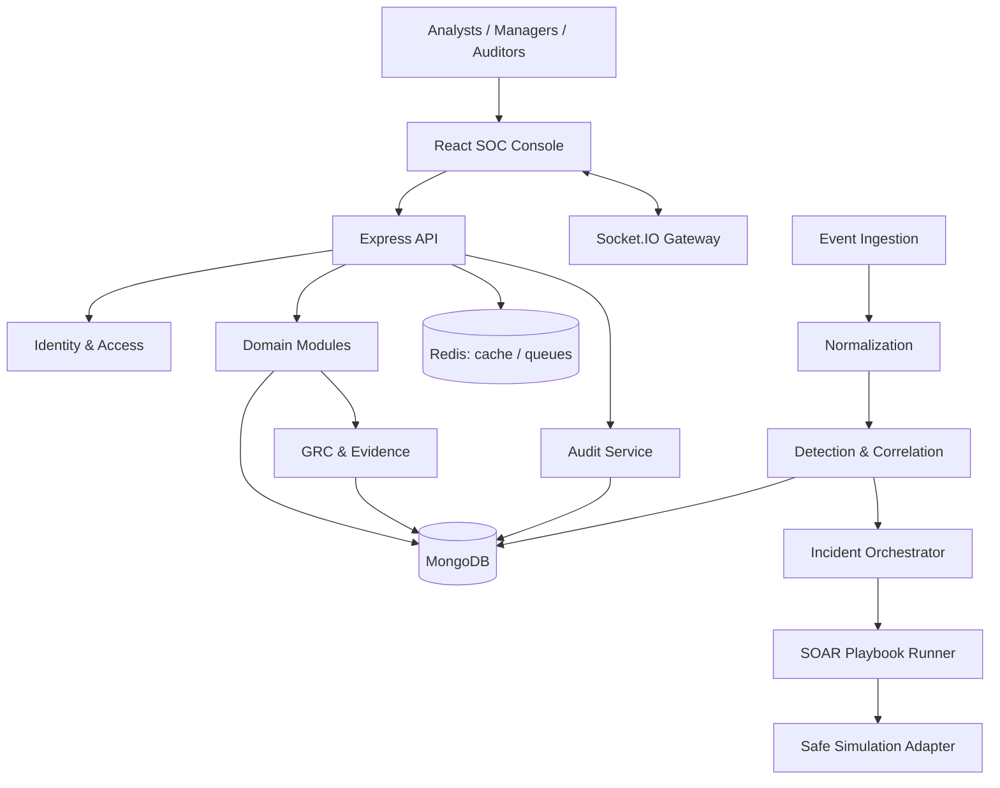

# System Architecture

## 1. Goals and non-goals

### Goals
- Deliver a cohesive SOC workflow from telemetry intake through incident closure and compliance evidence.
- Support multiple organizations with strict tenant isolation.
- Keep detection logic deterministic, explainable, testable and versioned.
- Support real-time operational updates without making WebSocket delivery the source of truth.
- Keep modules independently testable and suitable for future service extraction.

### Initial non-goals
- Replacing a full enterprise SIEM data lake.
- Executing arbitrary commands on customer endpoints.
- Claiming autonomous AI decisions are authoritative security findings.
- Shipping live blocking or endpoint isolation integrations enabled by default.

## 2. Logical architecture

## 3. Deployment topology

Initial deployment is a modular monolith:
- One TypeScript API process exposes REST endpoints and the Socket.IO gateway.
- One React web application is deployed separately.
- MongoDB is the system of record.
- Redis is used for rate-limit coordination, caching and background work when introduced.
- A worker process handles asynchronous enrichment, report generation and playbook execution.

This avoids premature microservice complexity while preserving clear module boundaries. High-volume ingestion, detection workers or reporting can be extracted later using measured workload evidence.

## 4. Monorepo boundaries

- `apps/api`: HTTP API, authentication, domain services, persistence adapters, workers and realtime gateway.
- `apps/web`: SOC user interface and client-side state.
- `packages/contracts`: shared DTOs, validation schemas and event contracts. Never place server secrets or database models here.
- `packages/config`: shared lint, formatting and TypeScript configuration.
- `infra`: local containers, deployment manifests and operational scripts.
- `docs`: architecture decisions, threat model, API and runbooks.

## 5. Backend module boundaries

| Module | Responsibility |
|---|---|
| Identity | Users, sessions, MFA enrollment, authentication |
| Authorization | Roles, permissions, tenant and resource scope |
| Organizations | Tenant configuration and membership |
| Ingestion | Event intake, source identity, schema validation |
| Events | Normalized security event storage and search |
| Detection | Rule registry, correlation windows, scoring explanations |
| Incidents | Lifecycle, assignment, evidence, comments and SLA |
| Response | Playbooks, approvals, action adapters and execution logs |
| Threat intelligence | IOC records, source provenance, enrichment |
| Assets | Inventory, ownership, exposure and endpoint posture |
| Vulnerabilities | Findings, severity, remediation and patch state |
| GRC | Frameworks, controls, assessments and evidence |
| Audit | Append-only audit records and integrity verification |
| Reporting | Scheduled/on-demand operational and compliance reports |
| Notifications | In-app and future external notification channels |

Modules communicate through explicit service interfaces and domain events, not by importing each other's database models.

## 6. Data flow

1. An authenticated collector or authorized ingestion endpoint submits an event.
2. The API validates payload size, source authorization, timestamp and schema.
3. The ingestion layer normalizes the event and records source/provenance metadata.
4. Detection rules evaluate the event and relevant correlation window.
5. A finding includes rule ID/version, evidence references, score and explanation.
6. Incident policy creates or updates an incident according to deduplication/correlation keys.
7. Domain changes are persisted before realtime notifications are emitted.
8. Analysts investigate and may launch an approved playbook.
9. The response adapter runs in simulation mode by default and writes an execution record.
10. Audit and GRC services retain relevant evidence for later reporting.

## 7. Reliability and scale

- Paginate large collections with cursor-based pagination.
- Index tenant ID, event time, severity, status and correlation identifiers.
- Bound ingestion payload sizes and enforce per-source quotas.
- Make ingestion and worker jobs idempotent using stable event/job identifiers.
- Use an outbox pattern for reliable post-commit domain notifications as the event workload grows.
- Apply retention policies by tenant and data class.
- Measure throughput, queue delay, query latency and error rates before tuning or claiming scale.
- Use load tests with documented hardware, dataset and concurrency assumptions.

## 8. Realtime contract

REST/database state remains authoritative. Socket.IO is a notification channel only.
- Authenticate the socket handshake.
- Join rooms only after server-side tenant and permission checks.
- Never trust a client-supplied tenant room name.
- Emit minimal event payloads; clients fetch authorized details through REST.
- Reconnect and resynchronize using cursors or last-seen timestamps.

## 9. Architecture decisions

- Start with a modular monolith rather than microservices.
- Use MongoDB for flexible event and domain documents, with explicit schema validation and indexes.
- Use Redis only for workloads that need shared ephemeral state or queues.
- Keep rule-based detection as the deterministic baseline; AI assistance is advisory and must show evidence and confidence.
- Make response adapters safe by default and require explicit production enablement.
